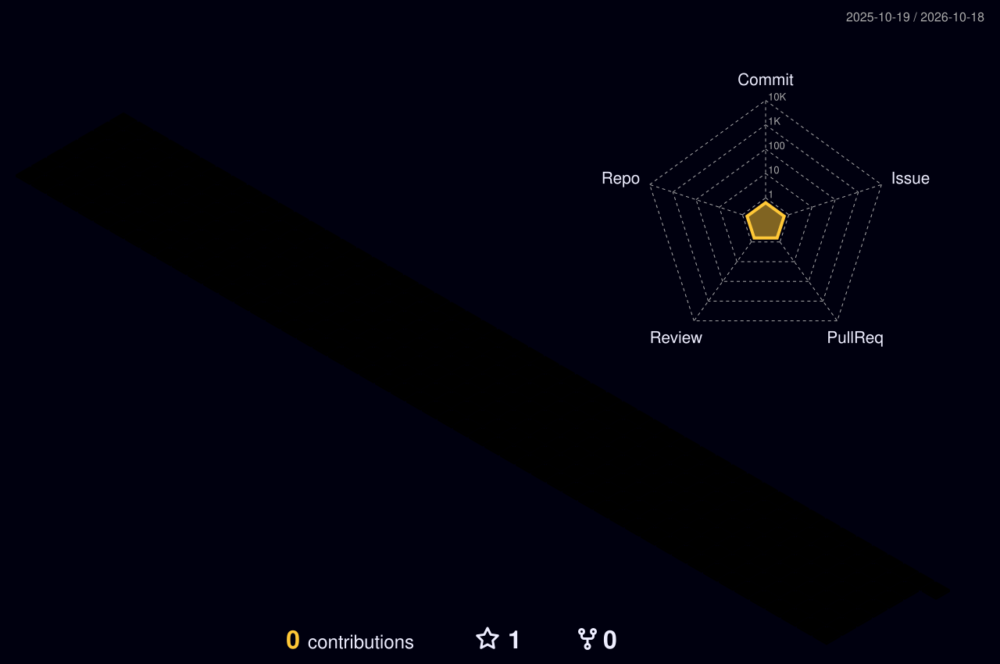

<!-- ============================================================
  SETUP: Poore file mein "YOUR_USERNAME" ko apne GitHub username se replace karo
  (VS Code mein Ctrl+H). Phir apni details (bio, links) bharo.
============================================================ -->

  <a href="https://YOUR-PORTFOLIO-WEBSITE.com"><b>My Portfolio Website</b></a>

  I currently hold the position of <b>YOUR ROLE</b> at <b>YOUR COMPANY</b>, based in <b>YOUR CITY</b>.
  Write 2-3 lines about your current work here.

  During my growth-oriented journey, I worked on <b>PREVIOUS ROLE / INTERNSHIP</b>.
  Write about your earlier experience here.

  I am a proud alumnus of <b>YOUR COLLEGE</b>, where I pursued <b>YOUR DEGREE</b>.

  Beyond my professional work, I enjoy <b>YOUR HOBBIES</b> (competitive programming, painting, travelling, gaming, etc.).

  In a nutshell, my journey has been a tapestry of academic excellence, professional growth and personal passions,
  all contributing to a well-rounded individual committed to continuous learning and innovation.

 

<!-- Illustration: apni pasand ki image assets/illustration.png (ya .gif) naam se upload karo -->

  

 

<!-- Badges row -->

  
  

  
  

⚡ <i>Fun fact: It is never too late to learn something.</i>

 

<!-- Connect with me -->
<h3 align="center">Connect with me:</h3>

  
  
  
  
  
  

 

<!-- Languages and Tools
  skillicons.dev ke icon names: https://github.com/tandpfun/skill-icons#icons-list
  Neeche list mein apne tools add/remove karo (comma-separated). -->
<h3 align="center">Languages and Tools:</h3>

  
   
  
   
  

 

<!-- Stats -->
<h3 align="center">Stats</h3>

  

  

  

<!-- 3D contribution graph (GitHub Action se generate hota hai, neeche Step 3 dekho) -->

  

<!-- Snake animation (GitHub Action se generate hota hai, 'output' branch se aata hai) -->

  <picture>
    <source media="(prefers-color-scheme: dark)" srcset="https://raw.githubusercontent.com/YOUR_USERNAME/YOUR_USERNAME/output/snake-dark.svg"/>
    <source media="(prefers-color-scheme: light)" srcset="https://raw.githubusercontent.com/YOUR_USERNAME/YOUR_USERNAME/output/snake.svg"/>
    
  </picture>

<!-- Footer banner (sunset wali image jaisa). Chaho to apni photo assets/footer.jpg upload karke use karo -->

  

